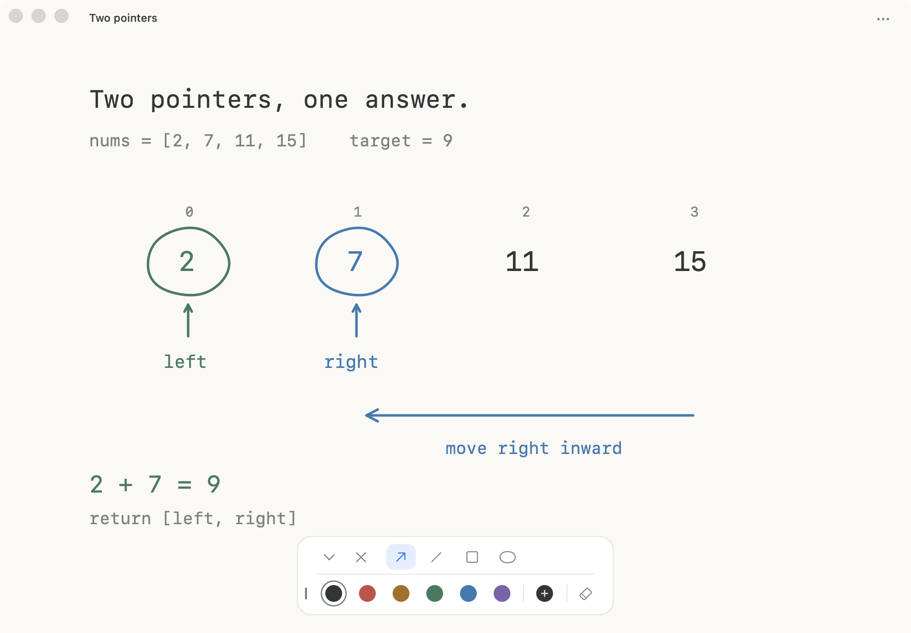

<div align="center">

# Inkey

**指到哪里，写到哪里。随手一拖，继续思考。**

为算法推演而做的 macOS 原生草稿纸，把变量、笔迹和关系画在一起。


[English](README.md) · [详细说明](docs/guide.md) · [反馈问题](https://github.com/lnk137/inkey/issues)

</div>



<sub>示例草稿，由 Inkey 的原生 AppKit 界面渲染。</sub>

## 不打断思路的草稿纸

在浏览器做题时，按 **⌃⌥Space** 呼出草稿，推演完再按一次回到题目。写字和绘画之间，不用来回找工具。

- **直接写，直接画。** 移动指针后打字，在新位置输入变量；拖动立即绘画，双击文字再精修。
- **触控板顺手用。** Shift 拖出箭头、直线、正方形或椭圆，捏合缩放，Option 拖动临时擦除。橡皮单击开关、右键调尺寸。
- **界面只留必要的。** 可编辑颜色预设、自定义调色、可折叠和隐藏的工具栏、可选十字轨迹，以及浮窗、常驻、全屏。
- **随时接着想。** 自动保存草稿并记住偏好，支持可编辑的 `.inkey` 文件和 PNG、PDF 导出。

Swift + AppKit。没有网页套壳、账户、遥测或第三方依赖。

## 开始使用

需要 **macOS 14+**、**Swift 6+** 和 Xcode 命令行工具。

```sh
git clone https://github.com/lnk137/inkey.git
cd inkey
./scripts/build-app.sh
open build/Inkey.app
```

Inkey 常驻菜单栏。当前版本供本机构建使用，采用本地签名，暂未提供经过公证的安装包。

## 记住这几个动作就够了

| 动作 | 效果 |
| :--- | :--- |
| **⌃⌥Space** | 呼出／收起草稿 |
| **移动指针 → 打字** | 在指针位置新建文字 |
| **拖动／⇧拖动** | 手绘／当前形状 |
| **双击文字／⌘Return** | 进入可选字的完整编辑 |
| **⇧1–4** | 选择 Shift 工具：箭头、直线、正方形、椭圆 |
| **⌥1–6** | 切换预设颜色 |
| **单击／右键橡皮** | 开关／调尺寸 |
| **⌥拖动** | 临时擦除 |
| **⌘E** | 导出 PNG、PDF 或可编辑草稿 |

呼出快捷键可以自定义。文字落点、工具栏显示状态、颜色、橡皮尺寸和窗口偏好都会自动记住。[查看完整操作说明 →](docs/guide.md)

## 保持轻巧，也保持可靠

```sh
swift test
```

测试覆盖写画切换、输入法、指针对齐、矢量擦除、草稿保存、导出和窗口切换。配图可通过 `./scripts/render-readme.sh` 重新生成。

欢迎[参与贡献](CONTRIBUTING.md)或[反馈问题](https://github.com/lnk137/inkey/issues)。

右键颜色预设可编辑或删除，在自定义调色盘中添加颜色（最多六个）；设置中可恢复默认色板。

画布始终使用十字指针；仅输入时显示文字插入光标，移动鼠标即隐藏。工具栏可用箭头折叠、× 隐藏；⌥⌘T 折叠／展开，⇧⌘T 显示／隐藏，也可从更多菜单找回。
